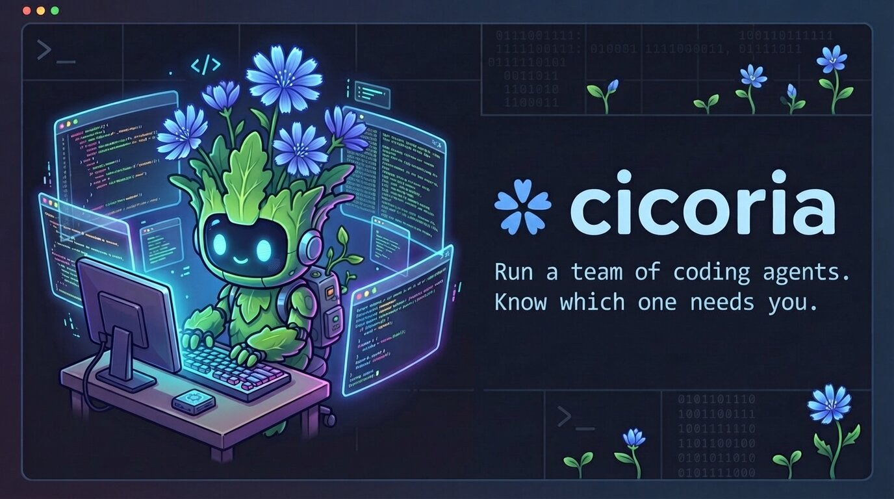

# cicoria



Work with several coding agents at once, in your terminal: see which one needs you, review what each one changed, and send your notes back.

cicoria is an interface for you, not an orchestrator. It does not run workflows between agents or keep them running without you: every message an agent gets is one you write or queue, or one another agent sends when you tell it to, and they stop when cicoria closes.

[](https://henomis.github.io/cicoria/demo.mp4)

Website and full documentation: <https://henomis.github.io/cicoria/>

## What it does

- **Runs any agent, untouched.** Each agent is its own command-line program in a real terminal pane, so nothing of its interface is lost.
- **Shows a status for every session**: working, needs input, or finished while you were elsewhere. One key jumps to the next session that needs you, and a desktop notification tells you when one starts waiting.
- **Keeps the changes of a session reviewable**: what is not committed or, one key away, everything since the commit it started on, so work the agent has already committed is still there. Diffs open full screen, with search and hunk navigation.
- **Lets you write notes on lines of code** and send them to the agent as one message.
- **Gives a session a git worktree of its own** when another one already works in its directory, so their changes are not mixed.
- **Shows two sessions at once**, one above the other.
- **Queues messages** and sends each one when the agent ends its turn.
- **Keeps a backlog on a board**: cards you write for work not started yet, next to every session in a column for what it needs from you. A card becomes a session only when you start it.
- **Draws a timeline of what happened, and what you did**: a bar per session for what its agent did over time, and under it a log in words of each answer, message, note and question of yours, so you know where you stand without reading the agents' consoles, and how long they waited for you.
- **Counts how your work went, over days**: turns by hour and by day, how many you typed and how many cicoria sent, how long they took, how long agents waited for you, and how many agents worked at once, from the same history.
- **Watches for brain fry**: a meter under the files says, in colour, how high the risk of the fatigue that comes from supervising many agents is now, from what you do in cicoria: long stretches without a pause, four or more agents at once, jumping between sessions, changes you have not opened, hours of activity in a day. A health view shows why, a hold pauses everything for a real break, and each diff says which turn made it.
- **Passes a question from one session to another**: you ask it, or tell an agent to, and the answer is handed back to the session it was asked from, so you stop copying between panes.
- **Follows you on your phone**: a web cockpit, turned on when you want it, puts first the sessions that need you and what they ask, shows what each agent said last and its changes, and takes your answers and queued messages, or only queued messages for a session you share to watch.
- **Remembers** sessions, their directories, notes and queues between runs. Claude Code, Copilot CLI and Codex CLI sessions continue their conversation.

Claude Code, GitHub Copilot CLI and Codex CLI get the full integration: their status comes from hooks, which cicoria gives the agents it launches without touching your settings, and the files they edit are highlighted. For any other agent, status is guessed from terminal activity.

## Install

```sh
curl -fsSL https://henomis.github.io/cicoria/install.sh | sh
```

The [script](web/install.sh) downloads the latest [release](https://github.com/henomis/cicoria/releases) for your system (Linux and macOS, x86_64 and arm64), checks it against the checksums of the release and puts `cicoria` in `~/.local/bin`. `CICORIA_INSTALL_DIR` names another directory and `CICORIA_VERSION` another release, such as `v0.0.4`. Running it again updates cicoria.

You can also download the archive from the releases yourself and put the `cicoria` in it on your `PATH`, or build it with Go:

```sh
go install github.com/henomis/cicoria@latest
```

Requirements:

- Go 1.26 or later, only to build it
- `git`
- the agents you want to run (`claude` by default, `copilot` for GitHub Copilot CLI, `codex` for Codex CLI)
- a Unix-like system; cicoria is developed and tested on Linux. Desktop notifications use `notify-send`, or `osascript` on macOS.

On Windows cicoria runs in [WSL2](https://learn.microsoft.com/windows/wsl/), with the archive for Linux. Install it, `git` and the agents inside the distribution, and keep the project in its file system rather than under `/mnt/c`, where git is slow. Desktop notifications need `notify-send` and a notification service in the distribution, and are skipped without them.

## Quick start

```sh
cicoria            # workspace opened on the current directory
cicoria ~/src/app  # or on another one
cicoria -version   # which version this is
```

Everything you type goes to the agent on screen. `ctrl+a` starts a cicoria command; `ctrl+a ?` lists them all, in a help screen that `j`/`k` or the arrows, `space`/`f`/`pgdn` and `b`/`pgup`, `g`/`G` or `home`/`end` and the mouse wheel scroll, and any other key closes.

| Key | Command |
|---|---|
| `c` | New session: pick the agent, its directory and a name |
| `1`-`9`, `n`, `p` | Go to a session |
| `a` | Go to the next session that needs input |
| `,` `r` `x` | Rename the session, restart it once its agent has exited, close it |
| `-` | Split: show another session below, or close the split |
| `tab` | Go to the other pane of the split |
| `w` | Open another workspace in place of this one |
| `o` | Worktrees: list them, open a session or a shell in one, or remove it |
| `0` | Board: the backlog, and every session by what it needs |
| `e` | Timeline: what happened, and what you did |
| `i` | Stats: how your work went, over days |
| `y` | Health: what is behind the brain fry meter |
| `z` | Hold: pause queues, notifications and the web cockpit for a break |
| `v` | Web cockpit: share sessions with a phone or a browser |
| `s` `f` `g` | Focus the sessions, files, changes panel |
| `l` | Focus the commits panel |
| `m` | Queue a message for the agent |
| `k` | Send a message to another session, or ask it and get the answer here |
| `u` | Focus the queue panel |
| `d` | Review changes: open the diff of the selected file |
| `t` | Send review notes to the agent |
| `h` | Review from here: count changes from the last commit |
| `/` | Find a file by name |
| `!` | Run a command in the session's directory, such as `make build` |
| `.` | Show the output of the last command run |
| `b` | Show or hide the side panels |
| `[` `]` | Show or hide the left, right panels |
| `space` | Command palette |
| `?` | Help |
| `q` | Quit |
| `ctrl+a` | Send `ctrl+a` to the agent |

These work in a full-screen file or diff too. `t`, `/`, `space` and `?` open over the file. `a`, `d`, `r`, `x`, `q`, `,` and `m` keep it on screen while they reply, ask, restart the session or, for `d`, show a diff in its place; going to another session, closing the one on screen or quitting leaves it. The other commands go back to the workspace.

The first time a Codex CLI session starts, Codex asks you to trust the hooks cicoria gives it: pick "Trust all and continue". Until then it works, but reports nothing.

In a side panel, `j`/`k` move, `enter` opens, `tab` goes to the next panel and `esc` gives the keys back to the agent; the status bar shows the other keys of the panel. The mouse works too. In the sessions panel, `,` renames, `r` restarts, `x` closes the session under the cursor, and `c` creates one.

The title of the agent pane names the session, its agent, its status, its directory and the git branch that directory is on, or the commit when it is on no branch. It follows a branch the agent switches to.

The mouse wheel and `pgup`/`pgdn` scroll back through what has left the agent's screen, and the title of the pane says how many lines back you are; typing goes back to the end. An agent that reads the mouse itself, or takes the whole screen as an editor does, gets the wheel and the keys instead.

`o` on a file, in the files and changes panels and in the full-screen view, hands it to the program the system opens it with (`xdg-open`, `open` on macOS, or `explorer.exe` in WSL): an image goes to the image viewer, a web page to the browser. A folder opens in the file manager.

The files panel also lists what git ignores, in grey; an ignored folder is read when you open it. `i` in the panel hides those files and shows them again, and `ignored_files = false` in the settings opens without them.

## Sessions

A session is one agent working in one directory, so one cicoria can hold sessions from several projects. `ctrl+a c` asks for the agent, then the directory (`tab` completes, `ctrl+w` deletes a path component, `ctrl+u` clears, and `~` and relative paths work), then a name, offering one that is free.

### A worktree of its own

The files and changes panels show the project of the session on screen, so two sessions in one git work tree cannot be told apart by their changes, and their agents write over each other. When you create a session where another one already works, cicoria asks whether to give it a [git worktree](https://git-scm.com/docs/git-worktree) of its own: `y` makes one, `n` or `enter` puts the session in the same directory and warns you, `esc` gives up. A `shell` is a way to run a command without leaving cicoria, not a session at work: it is not asked, opens in the directory you give it, and is no reason to offer the next session a worktree.

The worktree is named after the session: for a session `fix-login` on `~/src/app` it is `~/src/app.worktrees/fix-login`, on the commit the directory was on and on no branch: cicoria does not make one, so naming it is up to the agent or to you. In the name, anything but letters, digits, `-` and `_` becomes `-`. The session works there from then on, and comes back there after a restart. With `worktree_dir` in the settings, worktrees go there instead, in a directory named after the repository: with `worktree_dir = "~/worktrees"`, `~/worktrees/app/fix-login`.

Closing the session offers to remove the worktree, once its agent has ended. A branch made there is always kept, so what was committed on it is not lost. A worktree with changes that are not committed, with commits that are on no branch, or with files you cannot delete (such as a `node_modules` a container made as root) is kept too, unless you say otherwise: see below. Files git ignores are deleted with the worktree.

`ctrl+a o` lists the worktrees of the repository on screen, whoever made them, the ones that can go first: each says whether it can be removed, why it is kept, or which session works there. `enter` on one offers what can be done with it: go to the session that works there, start a new session there, such as an agent to commit or branch what a kept worktree holds, open a shell there, or remove it. Removing one that can go asks first, and what keeps it is looked at again then. One kept for changes that are not committed or commits on no branch can be removed anyway: cicoria says what is lost and asks first, and its teardown still runs. One kept for files you cannot delete cannot be removed from cicoria.

When the worktree of a closed session must be kept, cicoria asks what to do once its agent has ended. One kept for changes that are not committed or commits on no branch: `y` removes it anyway, and they are lost with it. One kept for files you cannot delete, or for a teardown that failed: `y` opens a shell there, to fix that, then `ctrl+a o` removes it. `n`, `enter` or `esc` keeps the worktree. Making a branch, and merging it, is up to you, or to an agent.

A worktree holds what git tracks: files that are not committed or that git ignores, such as `.env` or `node_modules`, are not in it. The ones it needs can be named in a `.worktreeinclude` file at the top of the project, written as a `.gitignore` is, the file Claude Code reads for its own worktrees: of the files git ignores, cicoria copies the ones it names into each worktree it makes. A file git tracks, or one it does not ignore, is never copied. The copies are the worktree's own, so the agent changes none of the originals. Claude Code asks whether it can trust the new folder, as it does for any.

```gitignore
# .worktreeinclude
.env
config/local.toml
```

What is installed rather than copied, such as `node_modules`, is the work of a setup the settings give for the repository (see [Configure](#configure)). cicoria runs it in each worktree it makes from that repository, in a shell session named after the session with `-setup` at the end, next to the agent, which does not wait for it. The shell session closes once the setup works; when it fails, it stays as a shell in the worktree, to read what went wrong and fix it. The setup is in your settings, never in the project, so a repository you clone cannot run a command of its own.

A `teardown` in the same settings runs in a worktree before cicoria removes it, such as `docker compose down`, also when it is removed anyway. When it fails, or takes more than two minutes, the worktree is kept, and cicoria offers a shell there.

Each session has 10 ports of its own, so that the dev servers of two worktrees do not fight over one: the first is in `CICORIA_PORT`, for the agent and for the setup of its worktree, which can write it where the project reads its port. Sessions take ranges from 20000 up, skipping one where a program listens already, and a session keeps its range after a restart. `port_base` and `ports_per_session` change that, and `port_base = 0` gives sessions no ports.

### Two sessions on screen

`ctrl+a -` splits the agent pane in two: the session on screen stays above, and the one you pick is shown below it. `ctrl+a tab`, or a click in the other pane, moves the keys from one to the other; the pane that has them is the one with the lit border, and the side panels show its project. Going to a session (`ctrl+a n`, `p`, `1`-`9`) puts it in the pane that has the keys, or moves the keys when it is already in the other one. The wheel scrolls the pane it is over.

`ctrl+a -` again goes back to one pane, as does closing one of the two sessions. A terminal too short for two panes keeps one, and the split is not remembered across restarts.

### Status

| Mark | Meaning |
|---|---|
| `●` | Working |
| `▲` | Needs input: the agent asks a question or a permission |
| `✓` | Finished its turn while you were looking elsewhere |
| `○` | Idle |
| `✕` | The agent's process has exited and the session was kept; `ctrl+a r` restarts it |

Each row also shows for how long the session has been in its status. The terminal's window title names the session on screen and its status, such as `api · working · cicoria`, after a `▲ name` for each other session that needs input, so a tab or a window in the background tells you too. The title the terminal had is put back when cicoria quits, where the terminal keeps a stack of titles, as xterm and GNOME Terminal do. A Claude Code, Copilot CLI or Codex CLI session that says it is working but has given no sign of life for 30 seconds reads `working?`, as after an interrupted turn.

A session closes when its agent or shell exits. It is kept, marked `✕`, when the agent exits within three seconds of starting, so that its error can be read, when it has queued messages, and when a file, the palette or a question is open at that moment. `close_on_exit = false` in the settings keeps every session.

### Run a command

`ctrl+a !` runs a command such as `make build` or `go test ./...` without opening a shell for it. It asks `run in api: ` on the status line and runs what you type with your `$SHELL`, in the directory of the session on screen (its worktree, if it has one) and with its `CICORIA_PORT`. `tab` completes the path you are typing, and `up` and `down` go through the commands run before, the last first, so running one again is `ctrl+a !`, `up`, `enter`. The workspace remembers the last 50.

The command runs in the background, and the status bar shows `▸ make build` while it does, then `✓ make build done (4s)` or `✕ make build: exit 2 (4s)`. `ctrl+a .` shows what it wrote, both streams, full screen, at its end, where a failure is told: `/` searches it and `q` goes back. While it runs, the view follows what it writes. Of a command that writes a lot, the last megabyte is kept.

A command gets no input: one that asks for some ends instead of waiting. Anything that needs a terminal, such as an editor, is for a `shell` session. Quitting cicoria stops the commands still running, and asks first.

## Review

The changes panel shows what is not committed. In it, `s` switches to everything the session changed since the commit it started on, committed or not, and back; the panel then says how many commits were made since, and `ctrl+a h` starts the count again from the last commit, once you have looked. With `changes = "session"` in the settings, sessions open on that view.

Under the changes, in either view, the commits panel lists the commits made since the session started, newest first, with their subject and age; it is there only once there is one. `enter` on a commit narrows the changes panel to the files of that commit, and its diffs to what the commit did, switching to everything since the session started if need be; `enter` on it again shows them all. `d` shows the whole commit as one diff on the full screen, where `tab` jumps from file to file; notes are written on the diff of one file, so it takes none. `@` mentions the commit to the agent, and `ctrl+a l` goes to the panel. Switching the view or the session, or `ctrl+a h`, shows all the changes again.

Files and diffs open on the whole screen: `j`/`k` move a line, `space`/`b` a page, `/` searches, `[` `]` jump between hunks, `tab` goes to the next changed file, `d` switches between the file and its diff, `w` wraps long lines instead of cutting them, `h`/`l` scroll the lines that are cut sideways, `m` switches a Markdown file between the document and its text, `e` opens `$EDITOR`, `o` opens the file with the system, `@` mentions the file to the agent, `q` goes back. The commands of the prefix work there too.

A Markdown file opened from the file tree or by its name is shown as the document it describes: headings, lists, tables and coloured code. Paragraphs are wrapped to the screen; tables and code keep their shape and, when wider than the screen, are cut with a `›` and scroll sideways with `h`/`l`. `[` `]` jump between headings. `m` shows its text instead, at the same place, and the choice holds for the files opened after it. Notes are written on the text, and the document marks where they are; a file opened from the changes panel, or next to its diff, is always text.

### Notes

A note is a remark on one or more lines of a file or diff. In the full-screen view, move to a line (or press `v` and move to select several) and press `c` to write one; `c` on a line that has a note rewrites it, `x` deletes it. Lines with a note carry a `*` in the margin.

Notes wait until you send them with `t`, in the view or after `ctrl+a`: all together, as one message that names each file and its lines, quotes them and gives your text. You choose whether it goes to the agent at once or through the queue.

## Queue

While an agent works you can line up what to tell it next. `ctrl+a m` asks for a message; the line can be edited with the arrows, `ctrl+w`, `ctrl+u` and the like. Messages wait in a panel under the changes and go to the agent one by one, each when it ends its turn; an idle agent gets the first at once, and so does one that has just started or restarted, a second after it is ready. Nothing is sent while the agent waits for a permission.

In the queue panel (`ctrl+a u`): `enter` sends the next message now, `p` pauses and resumes, `e` edits, `x` deletes, `J`/`K` reorder, `m` adds. Pause when a turn ends with a question you want to answer first.

Only Claude Code, Copilot CLI and Codex CLI say when their turn ends. Other agents keep a queue too, but each message is sent when you press `enter` in the panel. Queues are remembered across restarts and come back paused.

### Asking another session

`ctrl+a k` sends a message from the session on screen to another one. Pick the session, then either:

- **Send a message**: it is queued there, as `ctrl+a m` would do from that session.
- **Ask, and get the answer here**: the question is queued there, shown as `from <session>`. What its agent says at the end of the turn the question starts is queued back for the session you asked from, together with the question. A second prompt takes what that session should do with the answer; leave it empty to only hand the answer over.

The session that asked receives one message:

```
I asked the session "api":
> What does GET /orders return when the cart is empty?

It answered:
> A 200 with an empty `items` array, never a 404.

Update the client to handle it.
```

Neither agent knows of the other: one gets a message, the other a message with an answer in it. Only Claude Code and Codex CLI can be asked, since they are the ones that tell what they said when a turn ends: for Copilot CLI the choice says `not supported`, and the other agents are only sent messages. Only the turn the question starts counts: if it ends on an error, if you interrupt it, or if the agent says nothing, no answer is sent back and the status bar says so. A question that was still being answered when cicoria closed is lost too.

### Agents messaging each other

You can also tell an agent to do it: "send the cicoria session api a message saying the client handles empty carts", or "ask the cicoria session api which port it listens on". cicoria gives the agents it launches an [MCP](https://modelcontextprotocol.io) server of its own, `cicoria`, with three tools:

| Tool | Does |
|---|---|
| `list_sessions` | names the other sessions, with their agent, status and directory, and whether they can be asked |
| `send_message` | queues a message for another session, as `ctrl+a k` does |
| `ask_session` | queues a question there; what its agent says at the end of that turn is queued back for the agent that asked |

A session is named as the sessions panel shows it. The message reaches the other agent through its queue, when it ends its turn, and says which session's agent sent it; in the queue panel it reads `from <session>`, and the timeline says which agent sent it. A question returns at once: the answer comes later, as a message of its own that starts `You asked the session "api":`. The same agents can be asked as with `ctrl+a k`. A shell session takes no messages from agents, since it would run them as commands.

The server is given as Claude Code, Codex CLI and Copilot CLI are given their hooks, on the command line, without touching your settings. Your agent asks your permission to use a tool as it does for any MCP server: that is where you say yes or no. `agent_messages = false` in the settings gives agents no such tools.

## Board

`ctrl+a 0` shows the board on the whole screen: the backlog, then every session in the column of what it needs from you.

| Column | Holds |
|---|---|
| Backlog | Cards you wrote for work not started yet, in the order you give them |
| `▲` Needs you | Sessions whose agent asks a question or a permission, or could not start |
| `●` Working | Sessions whose agent is at work |
| `✓` To review | Idle sessions with something to look at: a turn that ended while you were elsewhere, changes or commits since they started, or notes not sent |
| `○` Settled | The others: idle with nothing new, or exited |

Each card is drawn in a frame of its own, lit when the cursor is on it. A card of a session names it, with its status and for how long; its agent, its branch and `wt` when it works in a worktree of its own; how many files it changed and commits it made since it started, its notes, its queue and `↗` when it is shared; and the start of what its agent last said. Where a session is follows from its state, so it moves when that does: a card cannot be moved to another column, and the board never starts or sends anything by itself.

`h`/`l` or the arrows go from column to column, `j`/`k` from card to card, `g`/`G` to the first and the last, and `a` to the next session that needs you. On a session, `enter` goes to it, `space` shows the end of its screen over the board, `m` queues a message for it, `d` goes to it with its changes panel, `e` shows its [timeline](#timeline), `r` restarts it, `x` closes it and `,` renames it. `q` or `esc` goes back, and so does `ctrl+a 0`; the other commands of the prefix go back to the workspace and run there. A click puts the cursor on a card, and a click on the card under it acts as `enter`. A terminal narrower than 100 columns lists the columns one under the other.

### Backlog

`c` writes a card in `$VISUAL` or `$EDITOR`: the first line is its title, and what follows is the first message its agent gets. A card of one line is its own message. `e` rewrites the card under the cursor, `x` deletes it, after asking, and `J`/`K` move it down and up. A card leaving the editor empty is kept as it was.

`enter` on a card starts it, as `ctrl+a c` starts a session: it asks for the agent, then the directory, offering the one the card was written in, then, in a git repository, whether to give it a worktree of its own, even when no other session works there: a card is work of its own, so `enter` takes the worktree here, and `n` does not. Then it asks for a name, offering one made from the title. The board stays on screen, with the cursor on the new session, and the card leaves the backlog; its agent gets the card's text once it says it is ready. Giving up on the way keeps the card. An agent that does not report its status gets the text when you press `enter` in its queue.

## Timeline

`ctrl+a e` shows on the whole screen what happened in the workspace, and what you did, so you do not have to read the agents' consoles to find out. `e` on a session of the board opens it with the cursor on what you last did there.

The first line says what time is shown, how long agents waited for you in it, and what else is left: notes not sent, messages queued. Then a bar for each session over that time, a full block `█` for each moment in the colour of what it was: yellow waiting for you, green working, grey idle, blue a turn that ended, red one that failed, and nothing while cicoria was closed. A closed session keeps its colours, faint. A `~` after a session's name says its agent does not tell what it does, so its bar is guessed from its output. Sessions that did nothing in that time are left out, and when there is no room for every bar the line under them says how many are not shown; those that wait for you are always shown.

Under the bars, what needs you now: each session that waits for you, the one that has waited longest first, with what it asks, then each one at work, with the message it works on. The timeline opens with the cursor there when a session waits.

Then the log of what you did, the newest first, in words, each line with a mark of what it is (`›` a message, `↵` an answer, `?` a question from another session, `□` a card, `◆` a commit, `✕` a failure): the answers you gave, with the choice and how long the agent waited for it; the messages you queued and sent, and the review notes; what you asked one session from another; the prompts you typed in an agent's pane; the turns you stopped; the cards you started, with their worktree. Each line that gave an agent a message says what came of it: `→ done in 12m, 3 files`, `→ ✕ failed after 4m`, `→ worked 5m, waits for you since 14:33`, `→ sent 12:40, done in 50m`, `→ still in the queue`. Commits are in it too, and turns that failed with no message of yours to say it. Under the line with the cursor, what the agent said at the end of its turn; over the bars, `▼━━` marks the time it is about, and its session's name is highlighted. A rule with the legend closes the screen.

It opens on the time since you were last away: since the last pause of ten minutes without a key, or since cicoria was closed, and at least half an hour. `+` and `-` show a shorter or a longer time, from half an hour to a week, and `s` the time since you were away again.

`j`/`k` move, and `g`/`G` go to the first and the last line; `a` goes to the next session that waits for you. `enter` goes to the session of the line, and `m` queues a message for it. `d` shows the turn of the line: what it was for, how long it took, the files the agent changed through its tools, the commits made in it, and what the agent said at its end. There, `d` or `enter` opens the diff of a file since the session started, or a commit, `v` the file itself, and `q` comes back to the turn. `q` or `esc` goes back. A terminal narrower than 60 columns has no bars.

The history is kept next to the saved sessions, in `events.jsonl`, readable only by you, for 30 days. Of the messages cicoria sends and queues, the notes, the prompts you type in the pane of Claude Code, Copilot CLI or Codex CLI, which tell them, and what the agent said at the end of each turn, it keeps the first 120 characters; keys never. `[timeline]` in the settings changes that. For an agent other than Claude Code, Copilot CLI and Codex CLI, turns are guessed from its output, and a burst shorter than two seconds is not kept.

## Stats

`ctrl+a i` shows on the whole screen how your work went in the workspace over days, counted from the history the [timeline](#timeline) keeps. It reads it all, up to 30 days, and acts on nothing.

It draws charts, and `t` shows the same as numbers instead, until cicoria closes: a punchcard of the turns by day of the week and hour, in shades from `·` for none to `█` for the most; the turns of each day, or of each hour today, as a column on its label, typed below and sent by cicoria above; how turns started and how many were cut short, as bars of the whole; how long turns took, and how long agents waited for you and for their next message, as histograms from under ten seconds to over fifteen minutes, the two waits back to back; and the most agents that worked at once in each day, or in each hour today, as a column a row high for each agent, up to four, on the same labels as the turns. A terminal narrower than 60 columns shows the numbers.

It shows the turns by hour of the day and by day of the week; how they started, typed by you in an agent's pane or sent by cicoria from the queue, the notes or another session, and how many were interrupted or failed; how long they took, as the median, the time three in four took less than, and the longest; how many times agents waited for you, for how long in all; how long an agent that ended a turn waited for its next one, idle after done, leaving out pauses of over four hours and the times cicoria was closed; and for how long one, two, three, or four or more agents worked at once. Then each agent, Claude Code, Codex CLI, Copilot CLI or another, with its turns, sessions, median turn, the share interrupted, how many times it asked you and how long it waited for you; a session opened before cicoria kept its agent in the history counts as not recorded. Last, the files agents changed most.

It opens on the last 7 days; `h`/`l` or the arrows show today or the last 30 days. `j`/`k`, `space`/`b` and `g`/`G` scroll, and `t` switches between charts and numbers. `q` or `esc` goes back, as `ctrl+a i` does. A terminal 100 columns wide or more shows two columns, and one narrower than 60 shows numbers without bars.

## Health

Supervising several agents at once tires in a way of its own, called "AI brain fry": a study of 1,488 workers (BCG, in Harvard Business Review, March 2026) found it in 17.8% of software engineers, with more mistakes, and output that grows with a second agent and falls from about the fourth. How it feels is a poor guide, so cicoria counts what you do. It never sends an agent anything for it.

The **brain fry meter**, a box under the files panel, shows the risk now as a bar and a word: empty and `low` in green, half full and `raised` in yellow, full and `high` in red, followed by the rule behind it when there is room. It is the highest level of these rules:

| Rule | Raised | High |
|---|---|---|
| Time you act in cicoria without a pause of 15 minutes | 1h30 | 3h |
| Four or more agents working at once, in the last hour | 10m, or four working now | 30m |
| Changes of session in the last hour | 20 | 40 |
| Files an agent changed that you have not opened since | 10 | 30 |
| Time acting in cicoria in the last 24 hours, pauses of 15 minutes or more left out | 4h | 6h |

A click on it, or `ctrl+a y`, opens the **health view**. First, live, every rule: its level (`·` low, `◇` near when it is three quarters of the way to raised, `▲` raised, `■` high, so colour is not all that tells them apart), its value, a bar of how far it is to its next level and where that is; under a rule that is near or up, its thresholds and what lowers it. Then, from the history, for today, the last 7 or the last 30 days (`h`/`l`) the longest stretch without a pause and how many breaks you took, how long four or more agents worked at once, the most changes of session in one hour, how long you acted in all, pauses left out, and for 7 or 30 days the most of it in one day, and last, for each session, the files it changed that you have not opened. `j`/`k` scroll, `z` holds, `q` or `esc` goes back. It counts keys and what the history records: reading a diff with no key pressed looks like a pause.

`ctrl+a z`, or `z` in the health view, **holds** everything for a break: every queue is paused, desktop notifications wait, and the web cockpit stops, so the phone does not call you back (its link is new when you start it again). It asks what is in your head and puts it on the backlog of the board as a note for you: started, that card sends the agent nothing. `esc` skips it. An agent in the middle of a turn finishes it, then waits. Any key or click ends the hold and opens the timeline on what happened since you left, and the status bar says where the note is; queues with messages stay paused, to resume one at a time with `p` in the queue panel, and `ctrl+a v` starts the web cockpit again.

Starting a session, or a card, that would make four agents work at once asks first: `enter` starts it anyway, `esc` gives up.

In the changes panel, a `•` at the start of the row marks a file the agent changed since you last opened its diff, and the title counts them. A file the agent writes through the shell, as with `sed`, counts too: when its turn ends, cicoria looks for the changed files written since it started, so a file you or another session in the same directory wrote meanwhile counts as well. It is kept only while cicoria runs: after a restart no file is marked until the agent changes it again. A diff opens on the turn that last changed the file: when it started, what it was for (your prompt, or the message cicoria sent), what the agent said at its end, and how many turns changed it before.

Brain fry comes from how much you supervise, not from the time of day, so no rule knows your working hours: a long day is long whenever it is. The thresholds come from research, not from your days, and may change.

## Web cockpit

`ctrl+a v` starts a small web server inside cicoria and shows its link as a QR code: point your phone at it and the page opens. It shows the sessions you share, and nothing else. The session on screen is shared when the cockpit starts; in its box, `space` shares or stops sharing the session under the cursor, `w` turns a shared session to watch only and back, `x` stops the cockpit and `esc` closes the box. A session shared to watch is marked `[w]`: the page can read it and queue messages for it, but not answer it, send it a message at once or interrupt it. Shared sessions are marked `↗` in the sessions panel, and the status bar says `web` while the cockpit runs.

The page lists the sessions in the columns of the board: those that need you, the one that has waited longest first, each with what it asks in one line; those at work, with what they are doing; those to review, with why, such as changes, commits or a turn that ended while you were away; and the settled ones. Each row names its agent, project, worktree and branch. Board shows the columns as a board, a card for each session: side by side on a wide screen, and on a phone one column at a time, picked from four segments at the top, each with the count of its column, Needs you in yellow while a session waits; it opens on the first column with something in it. Pressed again, it goes back to where you were. A session's page shows:

- **what it asks**, while it needs input: the agent's own words, the tool it wants to use with the directory it works in, such as the command it would run, and the choices of the menu on its screen. You answer with one of them, in words; cicoria reads the screen again first and refuses if the question changed. A choice such as "No, and tell Claude what to do differently" opens a box for what to do instead, sent once the answer is taken. A question without a menu is answered in your own words;
- **what it said last**, at the end of its turn (Claude Code and Codex CLI);
- **its queue**, where each message can be taken back;
- **its screen**, live, without frames, spinners and marks unless you switch on its exact layout, and what it is doing now. On a phone it is folded while the agent asks: the question says the same;
- **its changes**, since the session started or not committed yet, updated as the agent works: beside the rest on a wide screen, a page away on a phone.

You can send a message now or queue it, and interrupt an agent's turn after confirming it. While the agent shows a menu, a message is not sent at once, since it could pick one of the choices: answer first, or queue it. Each thing you do gets a receipt in words on the page, such as "Answered api: Yes" or why it was not done, and the status bar of cicoria says when something came from the web. A screen reader hears when a session changes status, and what it asks when it starts to need you; its screen is not redrawn while the reader is in it. The tab title names the session open and counts the sessions that need you. Sessions cannot be created, closed or restarted from there.

It listens on every address, on a free port, so a phone on the same network opens it; `web_address` changes that (`127.0.0.1:0` for this machine only, a Tailscale address for your devices, `0.0.0.0:7777` for a fixed port). The link holds a token that is new at each start and stops working with the cockpit. It is plain HTTP: on a network you do not trust, use a VPN or `tailscale serve`.

## Configure

`~/.config/cicoria/config.toml`, or under `$XDG_CONFIG_HOME` when that is set (all optional):

```toml
prefix = "ctrl+a"
default_agent = "claude"
notify = true            # desktop notification when a session not on screen needs input
left_panel = true        # false opens with sessions and files hidden; ctrl+a [ shows them
right_panel = true       # false opens with changes and the queue hidden; ctrl+a ] shows them
changes = "uncommitted"  # "session" opens on everything a session changed since it started
ignored_files = true     # false opens with the files git ignores left out of the files panel
close_on_exit = true     # false keeps a session whose agent has exited, to restart or close by hand
animations = true        # ASCII art when cicoria opens and quits, and a session is created or closed
agent_messages = true    # false gives agents no tools to message other sessions
web_address = "0.0.0.0:0"  # where the web cockpit listens: every address, a free port; "127.0.0.1:0" keeps it to this machine
port_base = 20000        # the first port given to sessions, in CICORIA_PORT; 0 gives none
ports_per_session = 10   # how many ports each session has to itself
worktree_dir = ""        # where worktrees go, as ~/worktrees/<repository>/<session>; "" puts them next to the repository

# What the timeline's history keeps of the messages and prompts you send,
# and of what agents answer: "none", "preview" (the first 120 characters)
# or "full"; and for how long.
[timeline]
text = "preview"
keep_days = 30

# The brain fry meter, and how many agents at once a new session is
# warned of: 0 for never.
[health]
meter = true
warn_agents = 4

# Any command line can be an agent. Its status is guessed from terminal
# activity: output means working, the bell means it needs input.
[agents.aider]
command = ["aider"]

# An entry named "claude", "copilot" or "codex" changes how Claude Code,
# Copilot CLI or Codex CLI is started. cicoria adds its own options at the end, so a launcher
# that passes the rest on ends with "--".
[agents.claude]
command = ["claude", "--model", "opus"]

[agents.copilot]
command = ["ollama", "launch", "copilot", "--model", "gemma4:cloud", "--"]

[agents.codex]
command = ["ollama", "launch", "codex", "--model", "gemma4:cloud", "--"]

# What to run in each worktree made from a repository, by its main
# work tree; ~ is the home directory. One [[worktree]] per repository,
# with a setup, a teardown or both.
[[worktree]]
repo = "~/src/app"
setup = ["npm", "ci"]
teardown = ["docker", "compose", "down"]
```

A plain `shell` is always available as a session type.

With `animations` on, a second of ASCII art plays in the agent pane when cicoria opens and quits and when a session is created or closed. Any key ends it.

## What is remembered

Sessions are saved for the directory cicoria was opened on, under `$XDG_STATE_HOME/cicoria` (or `~/.local/state/cicoria`), and reopened the next time with their directories, notes and queues, with the backlog of the board and the history the [timeline](#timeline) draws. Agents stop when cicoria closes: each is told that its terminal is gone, as when a terminal window is closed, and killed only if it is still there two seconds later; Claude Code, Copilot CLI and Codex CLI sessions continue their conversation when reopened.

A session belongs to the workspace it was created in, wherever it works: one created from `~/src/app` to work in `~/src/lib` comes back when cicoria is opened on `~/src/app`, not on `~/src/lib`. `ctrl+a w` lists the other saved workspaces, with the sessions of theirs that work in this directory and whether another cicoria has them open, and opens the one you pick in place of this one. A workspace that another cicoria has open is asked about before it is opened a second time, from there or with `cicoria` itself: its agents would run twice, on the same conversations. When cicoria is opened on a directory with nothing saved, the status bar says where the other sessions are.

## Develop

```sh
git clone https://github.com/henomis/cicoria
cd cicoria
make build      # build ./cicoria
make check      # formatting, vet and tests: run it before a commit
make lint       # golangci-lint, as the CI runs it
make test-real  # the test that embeds the real Claude Code
make site       # serve the website in web/ on http://localhost:8000
make help       # every target
```

The website lives in `web/` and is plain HTML, CSS and JavaScript, with no build step.

## The name

Cicoria is Italian for chicory. One grows in the agent pane each time you start.

The idea turned up uninvited at 5:15 in the morning of 11 October 2026 and took shape over the rest of the morning. Then its author went to cook chicory while an agent implemented the plan, and the project took its name from the pan. So cicoria was built the way it is meant to be used: the agent works and you watch the pan. Only one of the two tells you when it needs you.
