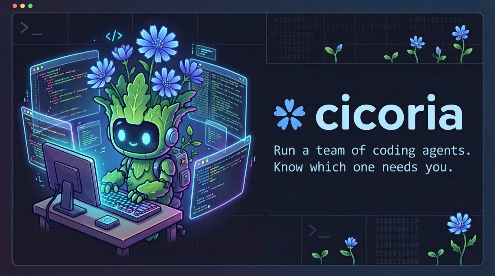

# cicoria



Work with several coding agents at once, in your terminal: see which one needs you, review what each one changed, and send your notes back.

cicoria is an interface for you, not an orchestrator. It does not run workflows between agents or keep them running without you: every message an agent gets is one you write or queue, agents never contact each other on their own, and they stop when cicoria closes.

[](https://henomis.github.io/cicoria/demo.mp4)

Website and full documentation: <https://henomis.github.io/cicoria/>

## What it does

- **Runs any agent, untouched.** Each agent is its own command-line program in a real terminal pane, so nothing of its interface is lost.
- **Shows a status for every session**: working, needs input, or finished while you were elsewhere. One key jumps to the next session that needs you, and a desktop notification tells you when one starts waiting.
- **Keeps the changes of a session reviewable**: what is not committed or, one key away, everything since the commit it started on, so work the agent has already committed is still there. Diffs open full screen, with search and hunk navigation.
- **Lets you write notes on lines of code** and send them to the agent as one message.
- **Gives a session a git worktree of its own** when another one already works in its directory, so their changes are not mixed.
- **Shows two sessions at once**, one above the other.
- **Queues messages** and sends each one when the agent ends its turn.
- **Passes a question from one session to another**: you ask it, and the answer is handed back to the session you asked from, so you stop copying between panes.
- **Remembers** sessions, their directories, notes and queues between runs. Claude Code, Copilot CLI and Codex CLI sessions continue their conversation.

Claude Code, GitHub Copilot CLI and Codex CLI get the full integration: their status comes from hooks, which cicoria gives the agents it launches without touching your settings, and the files they edit are highlighted. For any other agent, status is guessed from terminal activity.

## Install

```sh
curl -fsSL https://henomis.github.io/cicoria/install.sh | sh
```

The [script](web/install.sh) downloads the latest [release](https://github.com/henomis/cicoria/releases) for your system (Linux and macOS, x86_64 and arm64), checks it against the checksums of the release and puts `cicoria` in `~/.local/bin`. `CICORIA_INSTALL_DIR` names another directory and `CICORIA_VERSION` another release, such as `v0.0.4`. Running it again updates cicoria.

You can also download the archive from the releases yourself and put the `cicoria` in it on your `PATH`, or build it with Go:

```sh
go install github.com/henomis/cicoria@latest
```

Requirements:

- Go 1.26 or later, only to build it
- `git`
- the agents you want to run (`claude` by default, `copilot` for GitHub Copilot CLI, `codex` for Codex CLI)
- a Unix-like system; cicoria is developed and tested on Linux. Desktop notifications use `notify-send`, or `osascript` on macOS.

On Windows cicoria runs in [WSL2](https://learn.microsoft.com/windows/wsl/), with the archive for Linux. Install it, `git` and the agents inside the distribution, and keep the project in its file system rather than under `/mnt/c`, where git is slow. Desktop notifications need `notify-send` and a notification service in the distribution, and are skipped without them.

## Quick start

```sh
cicoria            # workspace opened on the current directory
cicoria ~/src/app  # or on another one
cicoria -version   # which version this is
```

Everything you type goes to the agent on screen. `ctrl+a` starts a cicoria command; `ctrl+a ?` lists them all, in a help screen that `j`/`k` or the arrows, `space`/`f`/`pgdn` and `b`/`pgup`, `g`/`G` or `home`/`end` and the mouse wheel scroll, and any other key closes.

| Key | Command |
|---|---|
| `c` | New session: pick the agent, its directory and a name |
| `1`-`9`, `n`, `p` | Go to a session |
| `a` | Go to the next session that needs input |
| `,` `r` `x` | Rename the session, restart it once its agent has exited, close it |
| `-` | Split: show another session below, or close the split |
| `tab` | Go to the other pane of the split |
| `w` | Open another workspace in place of this one |
| `s` `f` `g` | Focus the sessions, files, changes panel |
| `l` | Focus the commits panel |
| `m` | Queue a message for the agent |
| `k` | Send a message to another session, or ask it and get the answer here |
| `u` | Focus the queue panel |
| `d` | Review changes: open the diff of the selected file |
| `t` | Send review notes to the agent |
| `h` | Review from here: count changes from the last commit |
| `/` | Find a file by name |
| `b` | Show or hide the side panels |
| `[` `]` | Show or hide the left, right panels |
| `space` | Command palette |
| `?` | Help |
| `q` | Quit |
| `ctrl+a` | Send `ctrl+a` to the agent |

These work in a full-screen file or diff too. `t`, `/`, `space` and `?` open over the file. `a`, `d`, `r`, `x`, `q`, `,` and `m` keep it on screen while they reply, ask, restart the session or, for `d`, show a diff in its place; going to another session, closing the one on screen or quitting leaves it. The other commands go back to the workspace.

The first time a Codex CLI session starts, Codex asks you to trust the hooks cicoria gives it: pick "Trust all and continue". Until then it works, but reports nothing.

In a side panel, `j`/`k` move, `enter` opens, `tab` goes to the next panel and `esc` gives the keys back to the agent; the status bar shows the other keys of the panel. The mouse works too. In the sessions panel, `,` renames, `r` restarts, `x` closes the session under the cursor, and `c` creates one.

The title of the agent pane names the session, its agent, its status, its directory and the git branch that directory is on, or the commit when it is on no branch. It follows a branch the agent switches to.

The mouse wheel and `pgup`/`pgdn` scroll back through what has left the agent's screen, and the title of the pane says how many lines back you are; typing goes back to the end. An agent that reads the mouse itself, or takes the whole screen as an editor does, gets the wheel and the keys instead.

`o` on a file, in the files and changes panels and in the full-screen view, hands it to the program the system opens it with (`xdg-open`, `open` on macOS, or `explorer.exe` in WSL): an image goes to the image viewer, a web page to the browser. A folder opens in the file manager.

The files panel also lists what git ignores, in grey; an ignored folder is read when you open it. `i` in the panel hides those files and shows them again, and `ignored_files = false` in the settings opens without them.

## Sessions

A session is one agent working in one directory, so one cicoria can hold sessions from several projects. `ctrl+a c` asks for the agent, then the directory (`tab` completes, `ctrl+w` deletes a path component, `ctrl+u` clears, and `~` and relative paths work), then a name, offering one that is free.

### A worktree of its own

The files and changes panels show the project of the session on screen, so two sessions in one git work tree cannot be told apart by their changes, and their agents write over each other. When you create a session where another one already works, cicoria asks whether to give it a [git worktree](https://git-scm.com/docs/git-worktree) of its own: `y` makes one, `n` or `enter` puts the session in the same directory and warns you, `esc` gives up. A `shell` is a way to run a command without leaving cicoria, not a session at work: it is not asked, opens in the directory you give it, and is no reason to offer the next session a worktree.

The worktree is named after the session: for a session `fix-login` on `~/src/app` it is `~/src/app.worktrees/fix-login`, on a new branch `cicoria/fix-login` that starts from the commit the directory was on. In the name, anything but letters, digits, `-` and `_` becomes `-`. The session works there from then on, and comes back there after a restart.

Closing the session offers to remove the worktree. Its branch is always kept, so what was committed is not lost, and a worktree with changes that are not committed is kept too: the status bar says where it is. Merging the branch is up to you, or to an agent you ask.

A worktree holds what git tracks: files that are not committed or that git ignores, such as `.env` or `node_modules`, are not copied to it. Claude Code asks whether it can trust the new folder, as it does for any.

### Two sessions on screen

`ctrl+a -` splits the agent pane in two: the session on screen stays above, and the one you pick is shown below it. `ctrl+a tab`, or a click in the other pane, moves the keys from one to the other; the pane that has them is the one with the lit border, and the side panels show its project. Going to a session (`ctrl+a n`, `p`, `1`-`9`) puts it in the pane that has the keys, or moves the keys when it is already in the other one. The wheel scrolls the pane it is over.

`ctrl+a -` again goes back to one pane, as does closing one of the two sessions. A terminal too short for two panes keeps one, and the split is not remembered across restarts.

### Status

| Mark | Meaning |
|---|---|
| `●` | Working |
| `▲` | Needs input: the agent asks a question or a permission |
| `✓` | Finished its turn while you were looking elsewhere |
| `○` | Idle |
| `✕` | The agent's process has exited and the session was kept; `ctrl+a r` restarts it |

Each row also shows for how long the session has been in its status. The terminal's window title names the session on screen and its status, such as `api · working · cicoria`, after a `▲ name` for each other session that needs input, so a tab or a window in the background tells you too. The title the terminal had is put back when cicoria quits, where the terminal keeps a stack of titles, as xterm and GNOME Terminal do. A Claude Code, Copilot CLI or Codex CLI session that says it is working but has given no sign of life for 30 seconds reads `working?`, as after an interrupted turn.

A session closes when its agent or shell exits. It is kept, marked `✕`, when the agent exits within three seconds of starting, so that its error can be read, when it has queued messages, and when a file, the palette or a question is open at that moment. `close_on_exit = false` in the settings keeps every session.

## Review

The changes panel shows what is not committed. In it, `s` switches to everything the session changed since the commit it started on, committed or not, and back; the panel then says how many commits were made since, and `ctrl+a h` starts the count again from the last commit, once you have looked. With `changes = "session"` in the settings, sessions open on that view.

Under the changes, in either view, the commits panel lists the commits made since the session started, newest first, with their subject and age; it is there only once there is one. `enter` on a commit narrows the changes panel to the files of that commit, and its diffs to what the commit did, switching to everything since the session started if need be; `enter` on it again shows them all. `d` shows the whole commit as one diff on the full screen, where `tab` jumps from file to file; notes are written on the diff of one file, so it takes none. `@` mentions the commit to the agent, and `ctrl+a l` goes to the panel. Switching the view or the session, or `ctrl+a h`, shows all the changes again.

Files and diffs open on the whole screen: `j`/`k` move a line, `space`/`b` a page, `/` searches, `[` `]` jump between hunks, `tab` goes to the next changed file, `d` switches between the file and its diff, `w` wraps long lines instead of cutting them, `h`/`l` scroll the lines that are cut sideways, `m` switches a Markdown file between the document and its text, `e` opens `$EDITOR`, `o` opens the file with the system, `@` mentions the file to the agent, `q` goes back. The commands of the prefix work there too.

A Markdown file opened from the file tree or by its name is shown as the document it describes: headings, lists, tables and coloured code. Paragraphs are wrapped to the screen; tables and code keep their shape and, when wider than the screen, are cut with a `›` and scroll sideways with `h`/`l`. `[` `]` jump between headings. `m` shows its text instead, at the same place, and the choice holds for the files opened after it. Notes are written on the text, and the document marks where they are; a file opened from the changes panel, or next to its diff, is always text.

### Notes

A note is a remark on one or more lines of a file or diff. In the full-screen view, move to a line (or press `v` and move to select several) and press `c` to write one; `c` on a line that has a note rewrites it, `x` deletes it. Lines with a note carry a `*` in the margin.

Notes wait until you send them with `t`, in the view or after `ctrl+a`: all together, as one message that names each file and its lines, quotes them and gives your text. You choose whether it goes to the agent at once or through the queue.

## Queue

While an agent works you can line up what to tell it next. `ctrl+a m` asks for a message; the line can be edited with the arrows, `ctrl+w`, `ctrl+u` and the like. Messages wait in a panel under the changes and go to the agent one by one, each when it ends its turn; an idle agent gets the first at once. Nothing is sent while the agent waits for a permission.

In the queue panel (`ctrl+a u`): `enter` sends the next message now, `p` pauses and resumes, `e` edits, `x` deletes, `J`/`K` reorder, `m` adds. Pause when a turn ends with a question you want to answer first.

Only Claude Code, Copilot CLI and Codex CLI say when their turn ends. Other agents keep a queue too, but each message is sent when you press `enter` in the panel. Queues are remembered across restarts and come back paused.

### Asking another session

`ctrl+a k` sends a message from the session on screen to another one. Pick the session, then either:

- **Send a message**: it is queued there, as `ctrl+a m` would do from that session.
- **Ask, and get the answer here**: the question is queued there, shown as `from <session>`. What its agent says at the end of the turn the question starts is queued back for the session you asked from, together with the question. A second prompt takes what that session should do with the answer; leave it empty to only hand the answer over.

The session that asked receives one message:

```
I asked the session "api":
> What does GET /orders return when the cart is empty?

It answered:
> A 200 with an empty `items` array, never a 404.

Update the client to handle it.
```

Neither agent knows of the other: one gets a message, the other a message with an answer in it. Only Claude Code and Codex CLI can be asked, since they are the ones that tell what they said when a turn ends: for Copilot CLI the choice says `not supported`, and the other agents are only sent messages. Only the turn the question starts counts: if it ends on an error, if you interrupt it, or if the agent says nothing, no answer is sent back and the status bar says so. A question that was still being answered when cicoria closed is lost too.

## Configure

`~/.config/cicoria/config.toml`, or under `$XDG_CONFIG_HOME` when that is set (all optional):

```toml
prefix = "ctrl+a"
default_agent = "claude"
notify = true            # desktop notification when a session not on screen needs input
left_panel = true        # false opens with sessions and files hidden; ctrl+a [ shows them
right_panel = true       # false opens with changes and the queue hidden; ctrl+a ] shows them
changes = "uncommitted"  # "session" opens on everything a session changed since it started
ignored_files = true     # false opens with the files git ignores left out of the files panel
close_on_exit = true     # false keeps a session whose agent has exited, to restart or close by hand
animations = true        # ASCII art when cicoria opens and quits, and a session is created or closed

# Any command line can be an agent. Its status is guessed from terminal
# activity: output means working, the bell means it needs input.
[agents.aider]
command = ["aider"]

# An entry named "claude", "copilot" or "codex" changes how Claude Code,
# Copilot CLI or Codex CLI is started. cicoria adds its own options at the end, so a launcher
# that passes the rest on ends with "--".
[agents.claude]
command = ["claude", "--model", "opus"]

[agents.copilot]
command = ["ollama", "launch", "copilot", "--model", "gemma4:cloud", "--"]

[agents.codex]
command = ["ollama", "launch", "codex", "--model", "gemma4:cloud", "--"]
```

A plain `shell` is always available as a session type.

With `animations` on, a second of ASCII art plays in the agent pane when cicoria opens and quits and when a session is created or closed. Any key ends it.

## What is remembered

Sessions are saved for the directory cicoria was opened on, under `$XDG_STATE_HOME/cicoria` (or `~/.local/state/cicoria`), and reopened the next time with their directories, notes and queues. Agents stop when cicoria closes: each is told that its terminal is gone, as when a terminal window is closed, and killed only if it is still there two seconds later; Claude Code, Copilot CLI and Codex CLI sessions continue their conversation when reopened.

A session belongs to the workspace it was created in, wherever it works: one created from `~/src/app` to work in `~/src/lib` comes back when cicoria is opened on `~/src/app`, not on `~/src/lib`. `ctrl+a w` lists the other saved workspaces, with the sessions of theirs that work in this directory and whether another cicoria has them open, and opens the one you pick in place of this one. A workspace that another cicoria has open is asked about before it is opened a second time, from there or with `cicoria` itself: its agents would run twice, on the same conversations. When cicoria is opened on a directory with nothing saved, the status bar says where the other sessions are.

## Develop

```sh
git clone https://github.com/henomis/cicoria
cd cicoria
make build      # build ./cicoria
make check      # formatting, vet and tests: run it before a commit
make lint       # golangci-lint, as the CI runs it
make test-real  # the test that embeds the real Claude Code
make site       # serve the website in web/ on http://localhost:8000
make help       # every target
```

The website lives in `web/` and is plain HTML, CSS and JavaScript, with no build step.

## The name

Cicoria is Italian for chicory. One grows in the agent pane each time you start.

The idea turned up uninvited at 5:15 in the morning of 11 October 2026 and took shape over the rest of the morning. Then its author went to cook chicory while an agent implemented the plan, and the project took its name from the pan. So cicoria was built the way it is meant to be used: the agent works and you watch the pan. Only one of the two tells you when it needs you.
